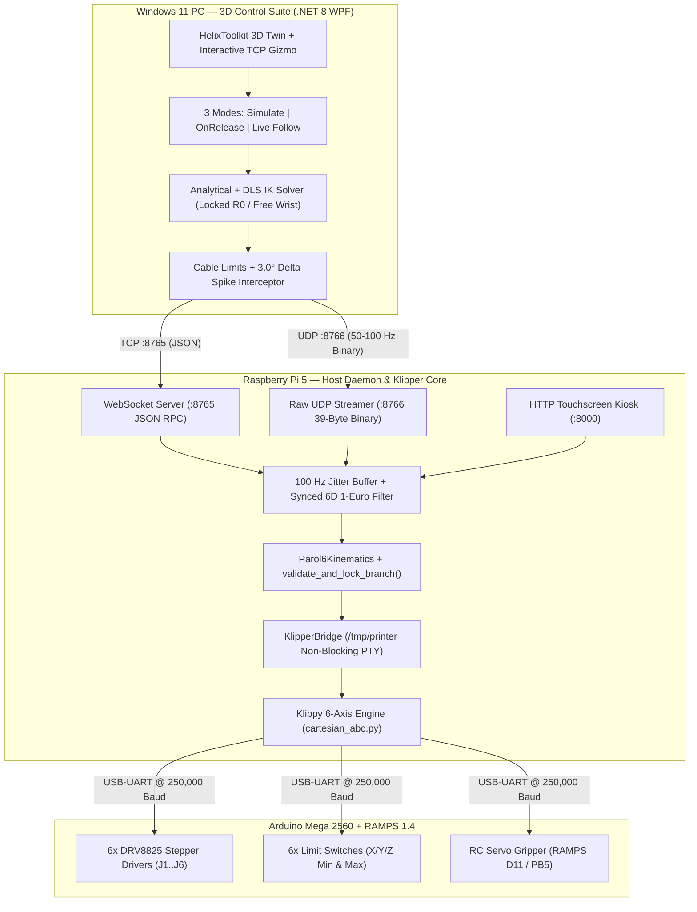

# PAROL6C — Custom 6-DOF Klipper Robotic Arm Control Suite

> **Complete Software Suite for a Custom PAROL6 6-DOF Robot Arm**  
> **Hardware Stack:** Raspberry Pi 5 + Arduino Mega 2560 & RAMPS 1.4 + Custom 6-Axis Klipper (`cartesian_abc`) + Touchscreen Kiosk + Windows .NET 8 3D Digital Twin Control Suite

---

## ⚠️ EXPERIMENTAL & "VIBE-CODED" DISCLAIMER

> [!CAUTION]
> **PLEASE READ BEFORE OPERATING PHYSICAL HARDWARE:**
> - This software suite is **experimental and vibe-coded** through iterative AI-assisted engineering and hardware-in-the-loop testing on a custom PAROL6 build.
> - **Robotic arms can move rapidly and with significant torque.** A bug, misconfiguration, serial glitch, or wrong coordinate can cause physical damage to the robot, tear internal wiring harnesses, or cause personal injury.
> - **Use at your own risk.** Always keep a physical **Emergency Stop (E-Stop)** switch cutting stepper motor power within immediate reach when testing or operating the arm.
> - Always test new trajectories in **Simulate Mode** first, verify homing calibration before enabling **Follow Mode**, and never leave the energized arm unattended.

---

## 1. Project Overview

**PAROL6C** is a complete end-to-end control ecosystem for a custom **PAROL6 6-DOF robotic arm** driven by an **Arduino Mega 2560 + RAMPS 1.4** shield (instead of the original custom STM32 PCB) and orchestrated by a **Raspberry Pi 5** and a **Windows 11 3D Digital Twin Control Suite**.

### Core Components
1. **6-Axis Klipper Motion Core (`printer.cfg` & `klipper-6axes_support/`)**:
   - Uses a custom 6-axis Klipper kinematics module (`cartesian_abc`) mapping joints **J1–J6** to coordinated `X Y Z A B C` axes in **degrees**.
   - High-speed microsecond-scheduled step pulse generation on the ATmega2560 at `250,000` baud with multi-stage sequential homing (`HOME_ALL`) and hardware endstop latching.
2. **Raspberry Pi 5 Real-Time Brain Daemon (`daemon/robot_engine.py`)**:
   - Bridges the Windows Control Suite and Touchscreen UI to Klipper's `/tmp/printer` PTY socket (`daemon/klipper_bridge.py`).
   - Provides a **Hybrid Dual-Transport Network Layer**:
     - **TCP WebSocket (`:8765`)** for reliable JSON RPC commands (`HOME`, `ESTOP`, `RESET`, `SET_GRIPPER`, `SET_TRIMS`, `MOVE_JOINTS`, `MOVE_CARTESIAN`).
     - **Raw Unbuffered UDP (`:8766`)** for 50–100 Hz packed 39-byte binary motion streaming (`SERVO_JOINTS`, `SERVO_CARTESIAN`) and 50 Hz binary telemetry feedback.
   - Features a **64-slot Circular Jitter Buffer**, **Analytical Spherical-Wrist + Damped Least-Squares (DLS) Inverse Kinematics** (`daemon/kinematics.py`), **Synchronized 6-Axis Adaptive 1-Euro Filtering** (`daemon/one_euro_filter.py`), and a **Stationary-Interlocked RC Servo Gripper Driver**.
3. **Windows 3D Digital Twin Control Suite (`Windows_ControlSuite/` / `PAROLC_ControlSuite_Test`)**:
   - Native **C# / .NET 8 WPF** desktop application powered by `HelixToolkit.Wpf`.
   - Real-time dual 3D visualization: **Opaque Live Robot** (from 50 Hz telemetry) and **Cyan Ghost Robot** (staged target pose).
   - **Three Explicit Interaction Modes**:
     1. **Simulate Only (`SIMULATE`)**: Purely virtual 3D kinematics testing; zero motion packets sent to the robot.
     2. **Send On Release (`ON-RELEASE`)**: Drag the 3D gizmo or sliders to preview the planned trajectory; executes a smooth, velocity-blended move on mouse release (or via the **COMMIT STAGED POSE** button).
     3. **Live Follow (`FOLLOW`)**: Continuous 50 Hz real-time teleoperation with sectional B-spline smoothing and decaying 3D trajectory trail.
   - **Two Inverse Kinematics Orientation Modes**:
     1. **Keep Tool Steady (Locked 3D Orientation)**: Strictly locks the $3 \times 3$ flange world rotation matrix $R_0$ across **every intermediate interpolated step** ($\pm X, \pm Y, \pm Z$, `OnRelease`, and `Follow` moves) so the tool never tilts, rolls, or yaws while translating.
     2. **Free Wrist (Probe / Tooltip Mode)**: Keeps the tooltip on the target $(X, Y, Z)$ coordinate while allowing the wrist angles to relax naturally.
4. **Touchscreen Kiosk UI (`ui/touchscreen.html`)**:
   - Served by the Pi daemon on `http://<pi_ip>:8000` for local 7" Raspberry Pi touchscreens.
   - Provides 1-tap homing, joint & Cartesian jogging, speed scaling, homing offset trim calibration, RC servo gripper control, and a live **Dual-Channel Communication Log** (`SUITE <-> RPI` and `RPI <->KLIPPER MCU`).

---

## 2. System Architecture



---

## 3. Kinematic Safety & Wrist Branch Protection

To prevent the wrist from flipping upside down or shearing internal wiring harnesses during Cartesian moves, both the Windows client and Raspberry Pi daemon enforce a multi-layer kinematic interceptor:

1. **Strict Flange World Orientation Lock ($R_0$)**:
   - Every intermediate waypoint along a linear Cartesian path preserves the exact $3 \times 3$ starting rotation matrix:
     $$T_k = \begin{bmatrix} R_0 & \mathbf{p}_k \\ \mathbf{0}_{1 \times 3} & 1 \end{bmatrix}$$
   - Synchronized 6-axis velocity scaling ensures all 6 joints scale proportionally when any axis approaches its speed limit, preventing inter-joint lag from tilting the tool.
2. **Deterministic Spherical Wrist Branch Locking**:
   - Evaluates both mathematical spherical wrist solutions ($[J_4, +J_5, J_6]$ vs. $[J_4 \pm 180^\circ, -J_5, J_6 \pm 180^\circ]$) using weighted Euclidean modular distance against $\mathbf{q}_{\text{current}}$ and locks strictly onto the minimum-travel branch.
3. **Collinear Singularity Crossing Guard ($|J_5| < 1.0^\circ$)**:
   - When $|J_5| < 1.0^\circ$, Joint 4 and Joint 6 become collinear. The solver locks Joint 4 to its active value ($J_4 = q_{\text{current}, 4}$) and resolves all projected roll onto Joint 6 ($J_6 = \operatorname{atan2}(R_{36}[1,0], R_{36}[0,0]) - J_4$), preventing opposite-direction wrist spinning.
4. **Mechanical Cable Protection Limits & $3.0^\circ$ Delta Interceptor (`validate_and_lock_branch`)**:
   - Relative to `CAD_HOME_DEG = [0, -90, 180, 0, 0, 180]`, all joints are strictly bounded within $\pm 180^\circ$ of CAD Home and within hardware cable limits:
     - **J1 (Base Yaw):** $[-170^\circ, +170^\circ]$
     - **J2 (Shoulder Pitch):** $[-150^\circ, +50^\circ]$ (CAD Home $-90^\circ$)
     - **J3 (Elbow Pitch):** $[+65^\circ, +290^\circ]$ (CAD Home $+180^\circ$)
     - **J4 (Forearm Roll):** $[-160^\circ, +160^\circ]$ (prevents internal harness twisting)
     - **J5 (Wrist Pitch):** $[-110^\circ, +110^\circ]$ (mechanical collision boundary)
     - **J6 (Tool Flange Roll):** $[0^\circ, +360^\circ]$ ($180^\circ \pm 180^\circ$ — prevents umbilical wrap)
   - Any candidate frame commanding a single-step jump $|\Delta J_i| > 3.0^\circ$ per $10\text{ ms}$ window is immediately rejected and logged.

---

## 4. Hardware Pinout (Arduino Mega 2560 + RAMPS 1.4)

| Axis | Joint Function | Step Pin | Dir Pin | Enable Pin | Endstop Pin | Gear Ratio | Steps / Deg | Cable Limits |
|:---:|:---|:---:|:---:|:---:|:---:|:---:|:---:|:---:|
| **J1** (`X`) | Base Yaw | `PF0` (A0) | `!PF1` (A1) | `!PD7` (D38) | `^PE5` (X-Min) | $10:1$ | `88.888889` | $[-170^\circ, +170^\circ]$ |
| **J2** (`Y`) | Shoulder Pitch | `PF6` (A6) | `!PF7` (A7) | `!PF2` (A2) | `^PE4` (X-Max) | $50:1$ | `444.444444` | $[-150^\circ, +50^\circ]$ |
| **J3** (`Z`) | Elbow Pitch | `PL3` (D46) | `PL1` (D48) | `!PK0` (A8) | `^PJ1` (Y-Min) | $50:1$ | `444.444444` | $[+65^\circ, +290^\circ]$ |
| **J4** (`A`) | Forearm Roll | `PA4` (D26) | `PA6` (D28) | `!PA2` (D24) | `^PJ0` (Y-Max) | $805:180$ | `39.753086` | $[-160^\circ, +160^\circ]$ |
| **J5** (`B`) | Wrist Pitch | `PC1` (D36) | `PC3` (D34) | `!PC7` (D30) | `^PD3` (Z-Min) | $480:109$ | `39.143731` | $[-110^\circ, +110^\circ]$ |
| **J6** (`C`) | Tool Roll | `PG1` (D40) | `PG0` (D41) | `!PK1` (A9) | `^PD2` (Z-Max) | $1:1$ | `8.888889` | $[0^\circ, +360^\circ]$ |
| **Grip** | RC Servo | `PB5` (D11) | — | — | — | 50 Hz PWM | $500\text{--}2500\ \mu\text{s}$ | $0^\circ\text{--}180^\circ$ ($62.5\text{--}0\text{ mm}$) |

---

## 5. Repository Structure

```text
PAROLC_Firmware/
├── README.md                          # Project overview, setup guide, credits & disclaimer
├── printer.cfg                        # Active 6-Axis Klipper configuration for Mega 2560 + RAMPS 1.4
├── Deploy-To-Pi.bat                   # One-click Windows deployment script to Raspberry Pi
├── daemon/
│   ├── robot_engine.py                # Main Pi 5 async daemon (WebSocket :8765, UDP :8766, HTTP :8000)
│   ├── klipper_bridge.py              # Non-blocking PTY bridge to Klipper (/tmp/printer)
│   ├── kinematics.py                  # 6-DOF FK/IK engine, spherical wrist solver & cable safety gate
│   ├── one_euro_filter.py             # Synchronized 6-axis adaptive 1-Euro teleoperation filter
│   ├── trajectory_planner.py          # Trapezoidal velocity profile generator
│   ├── offsets.json                   # Persistent homing calibration trims
│   ├── parol6.service                 # Systemd service unit (/etc/systemd/system/parol6.service)
│   └── requirements.txt               # Python package dependencies
├── klipper-6axes_support/             # Custom 6-axis Klipper kinematics module (cartesian_abc.py)
├── ui/
│   └── touchscreen.html               # Local Raspberry Pi touchscreen kiosk interface
├── Windows_ControlSuite/              # Native Windows C# / .NET 8 WPF 3D Digital Twin Control Suite
│   ├── PAROLC_ControlSuite.csproj     # .NET 8 WPF project file
│   ├── MainWindow.xaml / .cs          # Main 3D viewport, gizmo, jogging, modes & comm logs UI
│   ├── Models/RobotKinematics.cs      # C# 6-DOF FK/IK solver with strict R0 lock & branch guards
│   ├── Network/RobotWebSocketClient.cs# Dual TCP WebSocket (:8765) + Raw UDP (:8766) client
│   ├── ViewModels/MainViewModel.cs    # State machine (Simulate, OnRelease, Follow) & trajectory blender
│   └── Assets/                        # PAROL6 STL 3D link meshes (L0..L6)
├── urdf_model/
│   └── urdf/PAROL6.urdf               # Reference URDF geometric kinematics model
└── docs/
    ├── API_SPEC.md                    # Complete WebSocket, UDP & Klipper bridge API reference
    ├── COMMUNICATION_SPEC.md          # Hybrid TCP/UDP binary frame & jitter buffer specification
    └── WINDOWS_CONTROL_SUITE_MANUAL.md# Operator & developer manual for the Windows 3D Control Suite
```

---

## 6. How to Use & Setup Guide

### Step 1: Raspberry Pi 5 & Klipper Setup
1. Install Klipper with the 6-axis kinematics plugin from `klipper-6axes_support/klippy/kinematics/cartesian_abc.py` copied into `/home/<user>/klipper/klippy/kinematics/cartesian_abc.py`.
2. Copy [`printer.cfg`](printer.cfg) to `/home/<user>/printer_data/config/printer.cfg` (or `/home/<user>/printer.cfg`) and verify the serial port under `[mcu]`.
3. Copy the `daemon/` and `ui/` folders to `/home/<user>/parol6/` and install Python dependencies:
   ```bash
   pip install -r /home/<user>/parol6/daemon/requirements.txt
   ```
4. Install and enable the daemon service:
   ```bash
   sudo cp /home/<user>/parol6/daemon/parol6.service /etc/systemd/system/
   sudo systemctl daemon-reload
   sudo systemctl enable --now parol6.service
   ```

### Step 2: Launching the Windows 3D Control Suite
1. On Windows 10/11 (with **.NET 8.0 SDK** installed), open `Windows_ControlSuite` (or `PAROLC_ControlSuite_Test`) and double-click:
   ```cmd
   Launch-ControlSuite.bat
   ```
   Or build and run from PowerShell:
   ```powershell
   dotnet run --project Windows_ControlSuite\PAROLC_ControlSuite.csproj -c Release
   ```
2. Enter your Raspberry Pi's IP address (e.g., `192.168.0.159:8765`) in the top connection bar and click **CONNECT**.

### Step 3: Operating the Robot Safely
1. **Homing (`HOME ALL`)**:
   - Motion is hardware-locked until the arm is homed. Click **HOME ALL** in the Windows Suite or on the Touchscreen UI.
   - Once complete, the arm locks into the **CAD Home Pose** ($[0^\circ, -90^\circ, 180^\circ, 0^\circ, 0^\circ, 180^\circ]$) and the `HOMED` badge turns green.
2. **Choosing an Interaction Mode**:
   - **SIMULATE ONLY**: Drag the 3D TCP gizmo or sliders to test reachability and wrist behavior purely in the 3D viewport without moving the physical arm.
   - **ON-RELEASE (Staged)**: Drag the 3D gizmo to preview the planned path line; release the mouse button (or click **COMMIT STAGED POSE**) to smoothly execute the move.
   - **LIVE FOLLOW**: Enable real-time teleoperation where the physical robot smoothly shadows the 3D twin at 50 Hz.
3. **Choosing an IK Orientation Mode** (in the **Cartesian** tab):
   - **KEEP TOOL STEADY (Locked 3D Orientation)**: Locks the current tool roll/pitch/yaw matrix $R_0$. Use the tool orientation buttons (`Rx/Ry/Rz`) or quick presets (`Tool Vertical Down`, `Tool Horizontal Fwd`, `Lock Current Angle`) to set your desired tool angle, then translate freely in $X, Y, Z$.
   - **FREE WRIST (Probe / Tip Mode)**: Keeps the tooltip at $(X, Y, Z)$ while allowing the wrist orientation to adapt.
4. **Emergency Stop**:
   - Press the **SPACEBAR** on your keyboard or click the red **EMERGENCY STOP** button at any time to immediately halt motion and de-energize stepper drivers.

---

## 7. Credits & Acknowledgments

This project builds upon the incredible open-source work of several creators and communities:

- **[Petar Crnjak (Source Robotics)](https://github.com/PCrnjak/PAROL6-Desktop-robot-arm)** — Creator of the open-source **PAROL6** 6-DOF desktop robotic arm mechanical design, CAD models, URDF specifications, and kinematic geometry.
- **[Kevin O'Connor & The Klipper3d Community](https://github.com/Klipper3d/klipper)** — Creators of the **Klipper** 3D printer & motion control firmware architecture.
- **[Klipper 6-Axes Support Contributors](https://github.com/klipper-6axes)** — For the `cartesian_abc` 6-axis coordinated kinematics extension enabling `X Y Z A B C` stepper scheduling in Klipper.
- **[Helix Toolkit Contributors](https://github.com/helix-toolkit/helix-toolkit)** — For the open-source `HelixToolkit.Wpf` 3D rendering engine used in the Windows Digital Twin Control Suite.
- **Géry Casiez, Nicolas Roussel, and Daniel Vogel** — Authors of the *1€ Filter: A Simple Speed-based Low-pass Filter for Noisy Input in Interactive Systems* (CHI 2012), used for real-time teleoperation smoothing.
- **Mark Seijkens ([Quark1980](https://github.com/Quark1980))** — Hardware build, custom RAMPS 1.4 / Klipper integration, system architecture, and testing.
