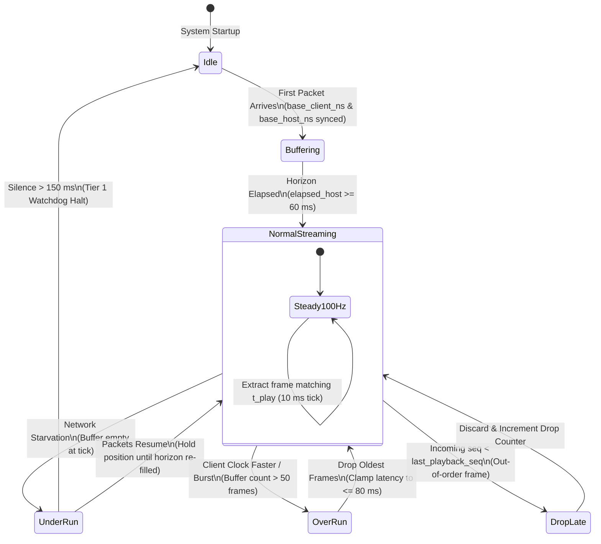

# PAROL6 Communication Protocol & Real-Time Motion Specification

---

## 1. Executive Architecture Summary

The PAROL6 6-DOF robotic control ecosystem implements an ultra-low latency, event-driven motion pipeline designed to eliminate trajectory jitter, prevent communication buffer overflows, and enforce strict fail-safe motor shutdown. 

Motion and control are cleanly partitioned across a **Hybrid Dual-Transport Layer** between the Windows Control Suite and the Raspberry Pi 5 Daemon, and a paced, bit-packed serial transport to the ATmega2560 hardware step core:

```
┌────────────────────────────────────────────────────────┐
│         Windows Laptop Test Suite (WPF / .NET 8)       │
│  - Interactive 3D URDF Viewport & TCP Transform Gizmo  │
│  - 100 Hz Raw UDP Binary Streaming Socket (Port 8766)  │
│  - Reliable TCP / WebSocket Control Client (Port 8765) │
└─────────────┬────────────────────────────┬─────────────┘
              │ Channel B: Raw UDP         │ Channel A: Reliable TCP
              │ 39-byte Packed Frames      │ WebSocket Handshakes & JSON
              │ Unbuffered 50–100 Hz       │ HOME, ESTOP, RESET, TRIMS
              ▼                            ▼
┌────────────────────────────────────────────────────────┐
│             Raspberry Pi 5 Host Daemon                 │
│  - Channel A: Async WebSocket Server (Port 8765)       │
│  - Channel B: Zero-Allocation UDP Server (Port 8766)   │
│  - Host-Side Jitter Buffer (64 slots, 60 ms horizon)   │
│  - Deterministic 100 Hz (10.0 ms) Sampling Worker      │
│  - Real-Time DLS / LM Inverse Kinematics (<1.0 ms)     │
│  - Dynamic Per-Joint Speed & Acceleration Clamping     │
│  - Microsecond Master Clock Estimator & Linear Filter  │
│  - Tier 1 Watchdog: 150 ms Inactivity Controlled Hold  │
│  - Paced UART Chunk Streamer (<= 2 chunks / 5 ms tick) │
└───────────────────────────┬────────────────────────────┘
                            │ USB-UART @ 250,000 Baud (11-byte Frames)
                            │ [0x55][axis_dir:u8][clock:u32][count:u16][interval:u16][add:i8]
                            ▼
┌────────────────────────────────────────────────────────┐
│      ATmega2560 + RAMPS 1.4 Hardware Step Core         │
│  - Virtualized 32-bit Master Clock (16 MHz Timer 1)    │
│  - Dynamic Compare Match OCR1A Hardware Interrupts     │
│  - Direct Register Step Generation (PORTx / DDRx)      │
│  - 2.5 µs Deterministic Pulse Width for TI DRV8825     │
│  - 6x Ring Buffers (64 chunks capacity per joint)      │
│  - Tier 2 Watchdog: 250 ms Inactivity Coil Shutdown    │
│  - Instant Homing Position Invalidation on E-Stop       │
└────────────────────────────────────────────────────────┘
```

---

## 2. Hybrid Transport Layer Architecture (Dual-Channel Network)

Communication between the Windows Control Suite and the Raspberry Pi 5 Host Daemon is divided across two dedicated channels to completely eliminate TCP Head-of-Line (HoL) blocking while preserving guaranteed delivery for mission-critical state transitions:

### 2.1 Channel A: Reliable TCP / WebSocket Control (Port 8765)
- **Protocol**: Full-duplex WebSocket over TCP (`ws://<robot_ip>:8765`).
- **Purpose**: Discrete commands, handshakes, state mutations, and configuration queries.
- **Payload Format**: Standard UTF-8 JSON.
- **Supported Operations**:
  - `HOME`: Triggers multi-stage sequential hardware homing.
  - `ESTOP`: Instant coil de-energization and buffer flush.
  - `RESET`: Clear alarm state and re-energize motor drivers.
  - `SET_GRIPPER`: Set servo PWM target pulse width (500–2500 µs).
  - `SET_SPEED_LIMITS`: Dynamically update master speed scale and per-joint velocity limits.
  - `GET_TRIMS` / `SET_TRIMS`: Read or persist endstop offset calibration in `daemon/offsets.json`.
  - `MOVE_TO_STAGED` / `MOVE_JOINTS`: Reliable execution of discrete staged poses.

### 2.2 Channel B: Raw UDP Motion & Telemetry Stream (Port 8766)
- **Protocol**: Unbuffered raw UDP datagrams (`udp://<robot_ip>:8766`).
- **Purpose**: High-frequency real-time motion follower streaming and bi-directional telemetry.
- **Jitter Tolerance**: Zero-allocation, connectionless delivery. If a UDP packet is delayed or dropped across Wi-Fi, it is dropped immediately without retransmission penalty. Late setpoints are discarded by the host-side jitter buffer.
- **Transmission Rate**: 50 Hz to 100 Hz continuous stream.

---

## 3. High-Frequency Binary Motion Frame (39 Bytes Fixed-Width)

All real-time UDP datagrams utilize a strictly packed, byte-aligned binary structure:

```
 0        1        2..3         4..11            12..35                36       37      38
+--------+--------+------------+----------------+---------------------+--------+-------+-------+
|  0xAA  | Opcode |  Sequence  |  Timestamp_ns  | Payload (6x float32)| Gripper| Flags | CRC8  |
| (uint8)| (uint8)| (uint16_le)|  (uint64_le)   |      (24 bytes)     | (uint8)|(uint8)|(uint8)|
+--------+--------+------------+----------------+---------------------+--------+-------+-------+
```

### 3.1 Field Specification

| Offset | Field | Type | Description |
| :---: | :--- | :---: | :--- |
| `0` | **Header** | `uint8` | Constant synchronization preamble: `0xAA` (170 decimal) |
| `1` | **Opcode** | `uint8` | Command / Telemetry operation identifier (see table below) |
| `2..3` | **Sequence** | `uint16_le` | Monotonically increasing 16-bit sequence counter (`0` to `65535` with rollover) |
| `4..11` | **Timestamp_ns** | `uint64_le` | Nanosecond monotonic client send timestamp (`Stopwatch.GetTimestamp()` or `time.perf_counter_ns()`) |
| `12..35`| **Payload** | `6x float32_le` | 24 bytes: 6 single-precision IEEE 754 floats.<br>• For `0x01`: Joint angles $[J_1, J_2, J_3, J_4, J_5, J_6]$ in **degrees**.<br>• For `0x02`: Cartesian TCP pose $[X, Y, Z, R_x, R_y, R_z]$ in **mm** and **degrees**.<br>• For `0x03`: Physical feedback joints $[J_1, J_2, J_3, J_4, J_5, J_6]$ in **degrees**. |
| `36` | **Gripper** | `uint8` | Commanded or actual gripper position (`0` to `180` degrees; maps to 62.5 mm -> 0 mm) |
| `37` | **Flags** | `uint8` | Bitfield representing hardware and motion states (see flags table) |
| `38` | **CRC8** | `uint8` | CRC-8-CCITT checksum calculated over bytes `0` through `37` |

### 3.2 Opcode Definitions

| Opcode | Identifier | Direction | Payload Structure |
| :---: | :--- | :---: | :--- |
| `0x01` | `SERVO_JOINTS` | Client $\to$ Host | Commanded target joint angles $[J_1..J_6]$ in **degrees** |
| `0x02` | `SERVO_CARTESIAN`| Client $\to$ Host | Commanded Cartesian tool pose $[X, Y, Z, R_x, R_y, R_z]$ in **mm / deg** |
| `0x03` | `TELEMETRY` | Host $\to$ Client | Physical live joint positions $[J_1..J_6]$ with echoed `Timestamp_ns` for RTT tracking |
| `0x05` | `HEARTBEAT` | Bidirectional | Client send timestamp in `Timestamp_ns`; immediate UDP pong reflection |

### 3.3 Status Flags Bitmask (Byte 37)

| Bit | Name | Active High (1) | Active Low (0) |
| :---: | :--- | :--- | :--- |
| `0` | `STREAMING_ACTIVE` | Real-time continuous streaming ON | Staged ghost mode |
| `1` | `CARTESIAN_MODE` | Cartesian vector $[X, Y, Z, R_x, R_y, R_z]$ | Joint angles $[J_1..J_6]$ |
| `2` | `HOMED` | All 6 axes homed and calibrated | Unhomed (motion strictly blocked) |
| `3` | `ESTOP` | Emergency Stop engaged / Coils off | Normal operation |
| `4` | `JITTER_BUFFER_ACTIVE`| Leaky bucket streaming locked | Initial buffering / idle |
| `5..7`| *Reserved* | Reserved for future expansion | Always `0` |

### 3.4 CRC-8-CCITT Checksum Specification

To guarantee transmission integrity against packet corruption without adding significant computational overhead, all binary frames validate using the standard CRC-8-CCITT algorithm:
- **Polynomial**: $x^8 + x^2 + x + 1$ (`0x07`)
- **Initial Value**: `0x00`
- **Lookup Table**: Pre-computed 256-element byte array executing in $O(1)$ constant time per byte:

$$\text{CRC}[i] = \text{Table}\big[\text{CRC}[i-1] \oplus \text{Byte}[i]\big]$$

```csharp
// High-Speed CRC-8-CCITT Table Lookup (C# Implementation)
public static byte ComputeCrc8(ReadOnlySpan<byte> data)
{
    byte val = 0;
    for (int i = 0; i < data.Length; i++)
        val = Crc8Table[val ^ data[i]];
    return val;
}
```

---

## 4. Host-Side Deterministic Jitter Buffer (Monotonic Leaky Bucket)

Incoming UDP datagrams across Wi-Fi networks suffer from burst clumping, transmission jitter, and non-deterministic kernel packet batching. The Raspberry Pi host daemon absorbs these variations using a pre-allocated circular jitter buffer (`JitterBuffer` in `daemon/robot_engine.py`):

```
                        INCOMING UDP PACKETS (50-100 Hz with Jitter)
                                         │
                                         ▼
                 ┌───────────────────────────────────────────────┐
                 │  Zero-Allocation CRC8 Validation & Unpacking  │
                 └───────────────────────┬───────────────────────┘
                                         │
                         ┌───────────────┴───────────────┐
                         │                               │
                 Late / Out-of-Order            Valid New Frame
                         │                               │
                         ▼                               ▼
                 ┌───────────────┐               ┌───────────────┐
                 │ Discard Frame │               │ Ring Buffer   │
                 │ (Count Drops) │               │ Push (Head)   │
                 └───────────────┘               └───────┬───────┘
                                                         │
                                    ┌────────────────────┴────────────────────┐
                                    ▼                                         ▼
                            Under-run (< 0 frames)                    Over-run (> 50 frames)
                            [Zero-Velocity Hold]                     [Skip Oldest Frames]
                                    │                                         │
                                    └────────────────────┬────────────────────┘
                                                         │
                                                         ▼
                                         ┌───────────────────────────────┐
                                         │ Deterministic 100 Hz Consumer │
                                         │ Clocked via time.perf_counter │
                                         │   dt = 10.0 ms strictly       │
                                         └───────────────┬───────────────┘
                                                         │
                                                         ▼
                                         ┌───────────────────────────────┐
                                         │ Levenberg-Marquardt IK / DLS  │
                                         │   + Quadratic Step Generator  │
                                         └───────────────────────────────┘
```

### 4.1 Jitter Buffer Operational Parameters
- **Slot Capacity**: Fixed 64 frames (pre-allocated array of `JitterBufferFrame` structures, zero runtime allocations).
- **Target Playback Horizon**: Nominal **$60.0\text{ ms}$** (configurable $50\text{ ms}$ to $80\text{ ms}$).
- **Sampling Cadence**: High-priority worker loop clocked strictly at **$100.0\text{ Hz}$ ($\Delta t = 10.0\text{ ms}$)** using high-resolution monotonic time (`time.perf_counter()`).

### 4.2 Jitter Buffer State Transition & Anomaly Handling



#### Anomaly Recovery Policies:
1. **Late / Out-of-Order Frames**:
   If an incoming packet has a sequence number or timestamp older than the current playback head (`(seq - last_playback_seq) & 0xFFFF > 0x8000`), the frame is discarded immediately (`packets_dropped_late += 1`).
2. **Buffer Under-Run (Starvation)**:
   If a transient Wi-Fi dropout causes the buffer to empty, the 100 Hz consumer **holds velocity at zero** at the last valid position setpoint. Discontinuous position jumps are mathematically prohibited. When packets resume, the buffer re-accumulates its 60 ms horizon before resuming motion.
3. **Buffer Over-Run (Clock Drift / Network Flushes)**:
   If the client clock runs slightly faster than the host clock, or if the network driver flushes an accumulated packet clump such that buffer depth exceeds 50 frames, the consumer skips the oldest frames, leaping forward to clamp motion latency strictly within the 80 ms limit.

---

## 5. Microcontroller Serial Protocol (USB-UART @ 250,000 Baud)

### 5.1 Compact Step Chunk Frame (`0x55`, 11 Bytes Fixed Width)

Step trajectories are discretized by the host into quadratic acceleration step chunks using the 11-byte `CompactStepChunk` format:

```
 0        1        2..5         6..7        8..9        10
+--------+--------+------------+-----------+-----------+--------+
|  0x55  |axis_dir|start_clock |step_count | interval  |add_scld|
| (uint8)| (uint8)|(uint32_le) |(uint16_le)|(uint16_le)| (int8) |
+--------+--------+------------+-----------+-----------+--------+
```

| Byte Offset | Field | Type | Description |
| :---: | :--- | :---: | :--- |
| `0` | **Header** | `uint8` | Constant sync byte `0x55` (ASCII `'U'`) |
| `1` | **axis_dir** | `uint8` | Bit-packed: `(dir << 7) \| (axis & 0x07)`.<br>Bits 0..2: Joint index (0 = J1, ..., 5 = J6).<br>Bit 7: Direction (1 = Positive, 0 = Negative). |
| `2..5` | **start_clock** | `uint32_le` | Absolute 16 MHz master clock tick when the first step fires |
| `6..7` | **step_count** | `uint16_le` | Total number of step pulses in this quadratic chunk |
| `8..9` | **interval** | `uint16_le` | Clock ticks between initial step pulses ($t_{\text{step}} = \text{interval} \times 62.5\text{ ns}$) |
| `10` | **add_scaled** | `int8` | Scaled acceleration delta per step ($\Delta \text{interval} = \text{add\_scaled} \times 4$ ticks) |

### 5.2 UART Buffer Flow Control & Pacing
- The ATmega2560 UART FIFO is strictly 64 bytes (`SERIAL_RX_BUFFER_SIZE = 64`).
- The host trajectory streamer limits serial output to **$\le 2$ chunks (22 bytes) per 5 ms tick cycle**, leaving $>40$ bytes of headroom for incoming pings and E-Stop tokens.
- All single-byte ASCII maintenance commands (`'H'`, `'I'`, `'D'`, `'M'`, `'G'`) require trailing newlines (`\n`), eliminating false triggers from binary payload bytes.

---

## 6. Dual-Tier Watchdog & Fail-Safe Architecture

```
┌────────────────────────────────────────────────────────┐
│              Tier 1 Watchdog (Host Daemon)             │
│  Timeout: 150 ms                                       │
│  Heartbeat: Continuous UDP Ping / Poses at >= 15 Hz    │
│  Trigger: Heartbeat loss during active streaming       │
│  Action: Controlled Deceleration to HOLD Stop          │
│  State: Preserves Homing Calibration & Position        │
└───────────────────────────┬────────────────────────────┘
                            │ Continuous Step Chunks / Pings (>= 10 Hz)
                            ▼
┌────────────────────────────────────────────────────────┐
│              Tier 2 Watchdog (ATmega2560 MCU)          │
│  Timeout: 250 ms                                       │
│  Trigger: Serial bus silence from Host Daemon          │
│  Action: Immediate Coil De-energization (Hardware Off) │
│  State: Clears homed_mask = 0 (Position Invalidated)   │
└────────────────────────────────────────────────────────┘
```

- **Tier 1 (Client-to-Host @ 150 ms)**: If the client stops transmitting for $>150\text{ ms}$, the host decelerates smoothly to an immediate **HOLD** stop. Joint coordinates remain valid.
- **Tier 2 (Host-to-MCU @ 250 ms)**: If the host daemon halts or crashes, the MCU pulls all motor `ENABLE` pins HIGH within 250 ms, de-energizing stepper coils to prevent collisions. Because de-energized motors drop under gravity, `homed_mask` is cleared to `0x00`, strictly requiring re-homing upon recovery.

---

## 7. Socket Port Bindings & Network Configuration

| Transport | Port | Protocol | Data Structure | Direction | Description |
| :---: | :---: | :---: | :---: | :---: | :--- |
| **TCP** | `8765` | WebSocket | JSON UTF-8 | Full-Duplex | Discrete commands, homing handshakes, trims, E-Stop |
| **UDP** | `8766` | Raw Datagram | 39-byte Packed Binary | Full-Duplex | Real-time motion streaming (100 Hz) & Telemetry (50 Hz) |
| **HTTP** | `8000` | Web Browser | HTML / CSS / JS | Inbound | Touchscreen Kiosk Diagnostic User Interface |

---

## 8. Teleoperation Filtering & Step Timing Protection

### 8.1 Ingestion & Outlier Gate (Velocity Sanity Check)
To protect physical stepper motors and reduction gearboxes from instantaneous target steps, mouse slips, multi-monitor dragging jumps, or IK numerical singularities, all streaming joint setpoints are passed through a velocity sanity gate before step synthesis:

$$\omega_i = \frac{\theta_{\text{incoming}, i} - \theta_{\text{filtered}, i}}{\Delta t}$$

If $|\omega_i| > \omega_{\text{limit}, i}$, the discontinuous jump is clamped to the maximum permissible rotational velocity for that specific axis:

$$\theta_{\text{target}, i} = \theta_{\text{filtered}, i} + \text{sign}(\Delta \theta_i) \cdot \omega_{\text{limit}, i} \cdot \Delta t$$

Default physical joint velocity limits ($\omega_{\text{limit}}$):
- Joint 1 (Base): $60.0^\circ/\text{s}$
- Joint 2 (Shoulder): $30.0^\circ/\text{s}$
- Joint 3 (Elbow): $30.0^\circ/\text{s}$
- Joint 4 (Forearm Roll): $40.0^\circ/\text{s}$
- Joint 5 (Wrist Pitch): $40.0^\circ/\text{s}$
- Joint 6 (Wrist Roll): $60.0^\circ/\text{s}$

### 8.2 Overdue Step Pacing & 100 kHz Peak Pulse Ceiling
If a step chunk arrives late due to network jitter or UART queuing, `c->first_step_clock` may lie in the MCU hardware past (`first_step_clock < now`). 
To prevent runaway 500 kHz interrupt bursts that cause motor stall and ISR starvation:
1. **Pacing Overdue Chunks**: When promoting or popping an overdue chunk, the MCU paces the first step from the current clock:
   $$\text{next\_step\_clock} = \text{now} + \text{interval}$$
2. **Rescheduler Minimum Delay**: The compare match rescheduler enforces a minimum floor of 160 ticks ($10.0\ \mu\text{s}$):
   $$\text{OCR1A} = \text{TCNT1} + 160$$
   This caps peak step frequency at 100 kHz per axis and guarantees foreground serial loop execution.

### 8.3 Follow-Mode Teleoperation 1-Euro Filter Architecture
For smooth interactive 3D twin teleoperation without hand tremors or cursor noise, an adaptive 6-axis 1-Euro filter conditions target angles:
- **Low-Speed Cutoff ($f_{c,\text{min}} = 1.0\text{ Hz}$)**: Suppresses sub-pixel mouse hum and micro-tremors during static positioning.
- **Velocity Adaptation Factor ($\beta = 0.05$)**: Dynamically widens cutoff bandwidth during brisk movements to minimize tracking lag.
- **Derivative Cutoff ($f_{c,\text{deriv}} = 1.0\text{ Hz}$)**: Smooths derivative spikes during rapid directional reversals.

Mathematical formulation:
$$\alpha = \frac{1}{1 + \frac{\tau}{\Delta t}}, \quad \tau = \frac{1}{2\pi f_c}, \quad f_c = f_{c,\text{min}} + \beta \cdot |\dot{\theta}|$$

### 8.4 $C^1$ Velocity Boundary Continuity & Quadratic Step Chunk Synthesis
To ensure zero mechanical jerk and prevent abrupt motor accelerations between consecutive step chunks, the stepping engine enforces $C^1$ velocity continuity between consecutive step chunks $k-1$ and $k$:

$$\dot{\theta}_{\text{start}, k} = \dot{\theta}_{\text{end}, k-1}$$

For each chunk with step count $N$ and target average interval $\bar{i} = \frac{\text{mcu\_dt\_ticks}}{\text{abs\_steps}}$:
1. **Entrance Interval**:
   $$i_{\text{start}} = i_{\text{exit}, k-1}$$
   If the axis was stationary ($i_{\text{exit}, k-1} = 0$), buffer starved, or if direction reversed, the engine starts from a conservative crawl interval ($i_{\text{start}} = 1200\text{ ticks} \approx 13.3\text{ kHz}$) and accelerates upward.
2. **Exit Interval Calculation**:
   $$i_{\text{end}} = 2\bar{i} - i_{\text{start}}$$
   clamped to safe hardware limits $[160, 65535]$ ticks.
3. **Step Interval Increment (`add`)**:
   $$\text{add} = \text{round}\left(\frac{i_{\text{end}} - i_{\text{start}}}{N - 1}\right)$$
   clamped to signed 8-bit range $[-128, 127]$ for `CompactStepChunk`.
4. **Actual Chunk Exit Interval**:
   $$i_{\text{exit}} = i_{\text{start}} + (N - 1) \cdot \text{add}$$
   Chained directly into $i_{\text{start}}$ of the subsequent chunk.

### 8.5 Stream Dropout & Soft-Stop Deceleration Protection
When interactive teleoperation setpoints cease (e.g., user releases mouse gizmo, switches UI tabs, or transient network pause $>60\text{ ms}$):
- The robot does NOT slam steppers abruptly to a dead stop.
- The 100 Hz deterministic sampling worker detects $(t_{\text{now}} - t_{\text{last\_rx}}) > 60\text{ ms}$ and initiates a controlled deceleration ramp:

$$\dot{\theta}_{j, \text{new}} = \text{sign}(\dot{\theta}_j) \cdot \max(0, |\dot{\theta}_j| - a_{\text{decel}, j} \cdot \Delta t)$$

- Deceleration rate $a_{\text{decel}, j} = \max(a_{\text{joint}, j} \cdot \text{scale}, \frac{|\dot{\theta}_j|}{0.080})$ brings all axes smoothly to zero velocity within 50–100 ms ($80\text{ ms}$ nominal).
- Once velocity reaches 0, the controller transitions to position-hold in `IDLE` state with zero position snapback.

---

## 9. Automated Hardware-In-The-Loop (HIL) Diagnostic Suite

The ecosystem includes an automated, remote diagnostic test suite (`daemon/tools/run_hardware_tests.py`) deployable over SSH via `deploy/test_remote.ps1`:

| Benchmark | Test Scope | Pass Criteria | Typical Hardware Performance |
| :--- | :--- | :--- | :--- |
| **TEST 1: Serial Sync & Watchdog** | 100 consecutive 'P' clock sync pings; 300 ms deliberate comms stall. | 100/100 pings, RTT < 5.0 ms, zero framing errors, Tier 2 watchdog safe state verified. | 100/100 pings @ 2.57 ms avg RTT; safe state verified. |
| **TEST 2: Kinematic Accuracy** | 50 reachable 6-DOF Cartesian waypoints evaluated via Levenberg-Marquardt solver. | Max position error < 0.10 mm; compute latency < 1.5 ms on Pi 5. | Max error: 0.0719 mm; compute latency: 1.39 ms. |
| **TEST 3: UDP Jitter Buffer** | 1,000 packed 32-byte UDP frames blasted at 100 Hz with synthetic ±15 ms temporal jitter. | Deterministic 100 Hz extraction, 0 buffer overflows, <= 50 ms max buffered latency. | 1,000 frames sent, 993 extracted @ 10.38 ms uniform rate, 0 overflows. |
| **TEST 4: E-Stop & State Purge** | Queue loaded with step chunks; instant asynchronous ESTOP issued. | ACK latency < 5.0 ms; all 16 slots recovered per joint; ESTOP state confirmed. | ACK latency: 0.762 ms; 96/96 slots recovered; ESTOP state confirmed. |
| **TEST 5: Teleoperation Conditioning** | Sub-pixel tremor filtering, outlier jump clamping, sweep tracking lag, soft-stop ramp. | Noise attenuation > 40%, jump rate clamped to $\omega_{\text{limit}}$, lag < 100 ms, soft-stop in 50–100 ms. | 85.0% noise reduction, clamped to 24.0°/s, 81.9 ms lag, 80 ms soft-stop. |


